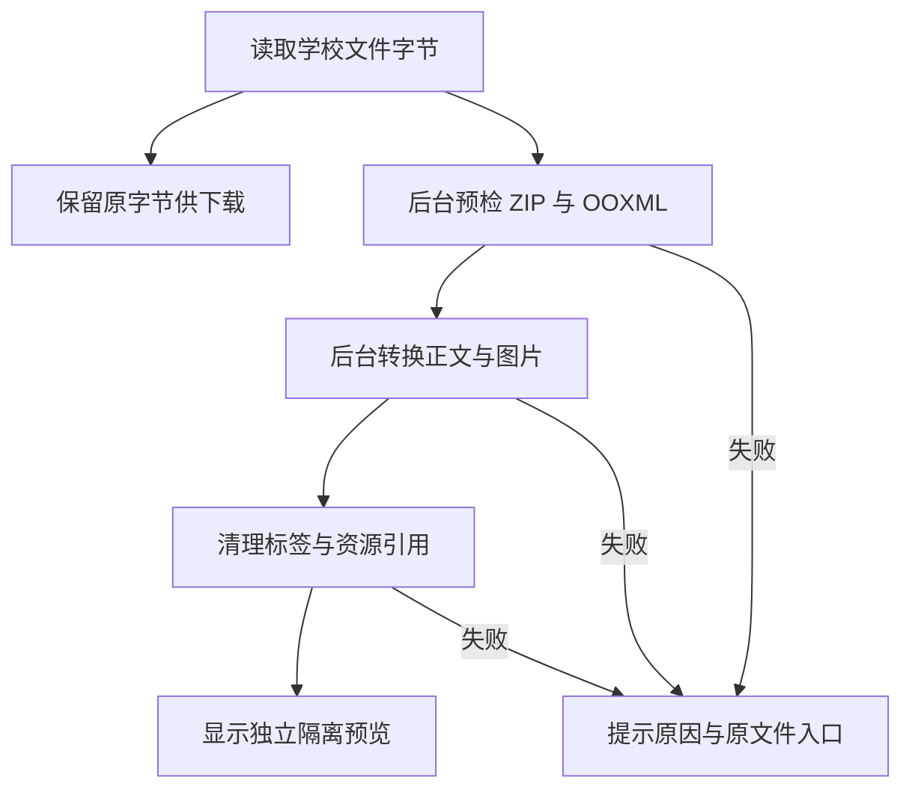

# DOCX 本地内容预览设计

_2026-10-13 · 用户已明确回复“确认草案，进入实施”；本文是批准规格，不表示功能已经实现。_

---

## 🎯 目标与范围

下一轮为现有文件预览加入 DOCX，而不是把它当作文本文件提取几行文字。先完成油猴版，再用同一核心接入扩展源码。保持 PDF 阅读器选择、图片与文本的现有行为，不提交商店审核，不发布新 Release，不扩大学校匹配或访问权限。

第一版保留正文、中文、标题层级、列表、基本强调、上下标、表格内容与合并单元格、脚注/尾注及常见内嵌图片。文档以连续阅读区显示，可以选中文字、滚动阅读和下载原始文件。表格提供清晰边界和必要的横向滚动；图片按阅读区宽度缩放。

不承诺 Word 原样分页、字体、颜色、页眉页脚或浮动布局。公式、SmartArt、图表、修订、嵌入对象及不支持的图片不得静默丢失：预检发现相关部件时显示局限提示；转换器报告未处理内容时汇总提示，原文件入口始终保留。复杂特性必须在真实样例中核对，不能只凭转换函数成功宣称内容完整。

本轮仅接管最终后缀 `.docx`；不接管 `.doc`、`.docm`、`.dotx`、PPTX、XLSX 或任意 ZIP。重命名的宏文档、加密 Office 和伪装文档明确拒绝。长期目标中的更多格式及降低安装门槛仍保留，后者按用户要求延后。

## 🔍 方案比较

| 方案 | 阅读效果 | 主要取舍 |
| --- | --- | --- |
| 本地语义内容预览（推荐） | 正文、列表、表格、图片 | 不还原 Word 分页与视觉样式 |
| 本地近似分页预览 | 更接近页面布局 | 字体、浮动、分页兼容要求更高 |
| 在线 Office 阅读器 | 可借助服务端渲染 | 需要外部网络，私有课件访问与隐私需另行设计 |

推荐第一种，与用户选择时接受的“不完全还原 Word 分页”一致。Mammoth 旨在生成语义 HTML，而非复制 Word 样式；官方列出标题、列表、表格、图片、脚注等能力，同时明确不清理恶意输入。[^1] 不采用纯文字输出作为最终 DOCX 阅读体验，也不直接沿用贡献 PR 的未隔离 HTML 或运行时 CDN。

拟锁定 Mammoth 1.13.0 负责转换、DOMPurify 3.4.17 配合项目白名单负责清理，ZIP 流式解压复用已锁定的 fflate 0.8.3。前两者版本是 2026-10-13 查询到的候选，不是已安装依赖或已验证的构建。实施前须核对具体发行内容、许可证、完整性和 Worker 兼容；不以修改本地依赖目录代替可复现构建。[^2][^3]

实施调查记录：fflate 0.8.3 在损坏 DEFLATE NLEN/Huffman 结构上存在漏检。保留它用于样例及转换副本打包，实际受限流式解压改用已核对的 pako 3.0.2 公开接口；测试覆盖合法包、损坏结构及实际字节计数。此内部依赖调整不改变批准的功能、资源预算、隐私或访问权限，不表示后续阶段已经验收。

## ⚙️ 模块与数据流

新增共享的 ZIP/OOXML 预检、后台内容转换、输出清理与生命周期模块；油猴和扩展只提供资源加载与界面适配。两版都从已有、获授权的文件读取流程取得字节。转换器不得取得远程课程 URL、任意磁盘路径或自行下载权限。

- `docx-package`：识别真实 DOCX、验证 ZIP 元数据及实际解压边界，输出受限的 OOXML 部件。无 DOM、网络和文件系统访问。
- `docx-worker`：只使用本地打包依赖，将有效内容转换为受限 HTML、内部图片数据和警告。禁用嵌入样式映射、外部文件读取以及 XML 外部实体；不执行文档中的任何代码。
- `docx-sanitize`：把转换结果视为不可信输入，使用固定标签与属性白名单。只有经过图片验证的内部资源可恢复为图片来源。
- `docx-runtime`：创建/终止后台任务，处理取消、超时、消息结构和过期结果；不从 DOM 或全局公开可变注册表取执行代码。
- 两个界面适配器：共用错误、原文件与原字节下载约定。DOCX 不显示 PDF 阅读器菜单；扩展不将 DOCX 误归为图片。

油猴继续提供一个可安装的 `.user.js`，把依赖、Worker 和许可随脚本打包；扩展使用随包分发的本地 Worker 文件。不得加入运行时 CDN、`@require`、远程执行、在线转换或额外的 GM 权限。学校 CSP 拒绝 Worker 时明确报错，不修改 CSP，也不把无上限转换挪到页面主线程来绕过限制。

## 🔐 文档隔离与资源限制

下载范围沿用现有 Canvas 精确链接校验。DOCX MIME 接受正式类型、空值或通用二进制类型，拒绝登录 HTML；ZIP 签名不能单独作为真实 DOCX 的证明。

### 拟定限制

| 边界 | 上限 | 执行位置 |
| --- | --- | --- |
| 原始 DOCX | 20 MiB | 网络读取与最终字节检查 |
| ZIP 项目数 | 1,000 | 解压前目录扫描 |
| 单项实际解压 | 20 MiB | 流式解压计数 |
| 全包实际解压 | 60 MiB | 流式解压总计数 |
| 单个 XML 部件 | 4 MiB | 转换前检查 |
| 转换 HTML（不含图片） | 4 MiB | Worker 返回与清理前 |
| 输出内容节点 | 50,000 | 转换与清理阶段 |
| 内嵌图片数 | 200 | 转换与输出阶段 |
| 图片总解码像素 | 40,000,000 | 头部与浏览器解码核对 |
| 后台预检及转换 | 20 秒 | 独立任务计时、超时终止 |

1 MiB = 1,048,576 字节。图片另沿用现有单边 16,384 像素、单图 4,000 万像素及字节限制，汇总所有图片以防大量小图片造成过量解码。以上是批准的初始产品限制，不是测得的性能保证；需要用边界样例和实际解码验证。

ZIP 必须按中央目录与本地头一致性校验，累计**实际**解压量，不只相信声明大小或先全量 `unzipSync` 再检查。校验 CRC、重叠数据区、截断、重复/冲突名称及路径；拒绝绝对路径、反斜线逃逸、父目录、加密、多卷 ZIP、ZIP64 和不支持的压缩方法。普通 STORE/DEFLATE、合法数据描述符及 DOCX 常见部件应有正向样例，不得用过于简单的 ZIP 白名单误拒绝正常文档。

须核对 `[Content_Types].xml`、根关系和正文部件，确认 Word 的非宏正文内容类型；拒绝宏、错误的 Office 类型、DTD/外部实体及重复关系 ID。内部关系只能解析到该包的受限部件；外部关系不触发网络、文件或其他协议访问。检测到需要外部图片或对象时保留说明，不暗中请求。

### 输出规则

清理器允许必要的段落、标题、强调、列表、表格、图片和内部脚注结构；删除脚本、事件属性、表单、SVG/MathML、嵌入页面、对象、外部 CSS、样式映射、任意 `style` 与远程资源。样式只来自项目的固定 CSS。ID 使用本次预览的内部命名空间，表格跨度为受限正整数，不允许内容污染宿主页面全局变量。

先移除全部未验证的 `src`、`href`、`srcset` 等资源入口。图片仅接受经检查与实际解码的内嵌 PNG/JPEG/WebP；不支持的 WMF/EMF、SVG、GIF 等显示占位和提示。HTTP、文件、`javascript:`、任意 data URL 不可恢复为活动链接。外部超链接保留可读标签及必要的文本地址，不提供自动跳转；内部脚注仅能指向当前文档验证过的目标，必须显式留在该隔离文档中，不能依赖 `srcdoc` 继承的学校页面基址。无法安全提供跳转时保留编号与脚注内容并提示，不允许因片段链接而请求学校页面。

清理后的正文进入**专用** `sandbox=""` iframe，不复用原生 PDF iframe，不授予脚本、同源、弹窗、表单、顶层导航或下载能力。固定 CSP 限制为无默认资源、仅已验证 data 图片及项目内联样式，禁止 base 和 form action；不存在在线资源回退。下载与原文件按钮放在可信的预览控制区，而非文档 iframe 中。sandbox、CSP 与清理器须分别有恶意文档测试，不能只依赖其中一层。

## 🔄 生命周期与失败处理

控制器保留原始 ArrayBuffer；给后台的是独立副本，不让转移或转换破坏下载。每次打开、重试、关闭、换文件或页面离开都更新代次，终止旧 Worker、取消请求、清空 iframe 和图片引用并撤销对象 URL。只接受当前任务及符合结构/大小边界的消息；旧结果不能覆盖新文件。

文件在完成读取、格式与包校验后可提供原字节下载。转换或清理失败时仍可下载已校验的原 DOCX；读取失败或非 DOCX 响应不伪装成已验证下载。错误需区分无权限/登录、非 DOCX、加密、损坏/CRC、超限、超时、CSP 与不支持的内容，不静默改用外部服务。

未知或复杂特性可以警告，但主要正文、支持的表格或常见图片缺失必须视为验收失败，不能用“阅读优先”掩盖产品缺陷。解析失败时也不能降级成只提取纯文字后宣称 DOCX 支持完成。

## ✅ 验收与交付门槛

1. 先覆盖精确后缀、MIME、Canvas 路由和文件限制，再覆盖合法 ZIP 变体、实际解压边界、CRC、重复路径、宏、伪装 Office、DTD/实体、外部关系及超时。
2. 使用原创的 Word/LibreOffice 可打开 DOCX 样例：中文正文、标题、嵌套列表、强调、脚注、合并单元格、表格与至少两种内嵌图片。检查可见排版、内容、图片像素、文字选择和逐字节下载，不以假 ZIP 或 mock HTML 作为最终渲染证据。
3. 恶意样例覆盖 `javascript:` 超链接、嵌入 style map、外部图片、SVG/活动 data URL、DOM clobbering、伪装 MIME 和解压炸弹；验证无代码执行、无意外请求、无宿主访问，并能正常关闭或取消。
4. 浏览器检查涵盖关闭/重开、快速换文件、异常 Worker、实际 CSP 拒绝、超时及对象 URL 清理；检查过期结果不复活、下载原字节不变。
5. 油猴先在隔离 Chromium/Firefox 集成测试，再用真实管理器安装验收，清楚区分模拟 GM、合成课程与真实安装。扩展接入后再跑 Chromium、Windows Edge、实际 Firefox 安装包检查与可复现构建。既有重启来源警告不能被本轮格式测试抹去。
6. 回归 PDF 原生/PDF.js 两种阅读器、密码与回退、图片与文本、普通下载和修改键点击；核对未扩大权限、无运行时远程代码、所有新增依赖许可、最终安装文件大小及哈希。

最终发布与版本号在实施计划中明确；源码交付和商店上架分开。油猴通过不代表扩展已完成，注入测试通过不代表全部管理器或真实课程兼容。

## 📋 审阅与下一步

用户已经确认本文包含的功能、安全限制和实施顺序。接下来提交设计并按阶段实施计划执行：共享安全核心、油猴接入、扩展同步及最终验收。不再为同一方案重复请求确认，不推进上架或新 Release。

自查已覆盖：范围与现有格式不冲突；油猴先交付、扩展后接入但共享核心；转换不取代清理；解压限额作用于实际输出；CSP 失败不绕过策略；失败与下载条件明确。Worker 发行兼容、许可证和样例保真是实施验收事项，不是已经通过的结论。

## 🔗 参考

[^1]: Mammoth. “Mammoth .docx to HTML converter”, README 与 Security 说明。https://github.com/mwilliamson/mammoth.js
[^2]: npm. “mammoth 1.13.0”, 查询日期 2026-10-13。https://www.npmjs.com/package/mammoth/v/1.13.0
[^3]: npm. “dompurify 3.4.17”, 查询日期 2026-10-13。https://www.npmjs.com/package/dompurify/v/3.4.17
